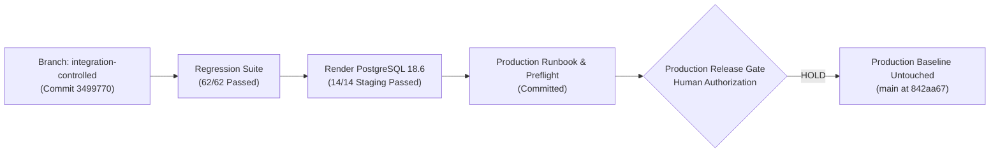

# SPORTYMILL — FORMAL PRODUCTION HANDOVER & RELEASE AUTHORIZATION REPORT

**Document Reference:** `SPORTYMILL_FORMAL_PRODUCTION_HANDOVER_AND_RELEASE_AUTHORIZATION_REPORT.md`  
**Execution Date:** November 16, 2026  
**Role:** Principal Software Engineer, Senior DevOps Engineer, PostgreSQL DBA, AppSec Engineer, Release Manager  
**Target Repository:** `https://github.com/Great-zeon/tipalgo.git`  
**Target Web Service:** `https://sporty-cn2q.onrender.com`  

---

## 1. EXECUTIVE SUMMARY

This report formally establishes the completion of all development, controlled integration, automated regression testing, cloud PostgreSQL staging verification, and production release runbook preparation for the SportyMill platform.

The application code, modular settlement engine, database migrations, and operational runbooks are completely reconciled and committed on the dedicated integration branch. 

In strict adherence to governance boundaries, **no changes have been made to production `main` or the live production database**. The production application remains running untouched on its verified baseline.



---

## 2. ACTUAL REPOSITORY STATE & HASH RECONCILIATION

An independent audit of the local repository was conducted prior to authoring this handover. All observed values match the reported governance values:

| Verification Target | Expected Value | Observed Repository Value | Status |
| :--- | :--- | :--- | :---: |
| **Current Git Branch** | `integration-controlled` | `integration-controlled` | **VERIFIED** |
| **Current HEAD Commit** | `3499770` | `34997703346719b162988660c89a3f757161343d` | **VERIFIED** |
| **Production Branch `main`** | `842aa67` | `842aa67a5866ec511cccfe3c39f2fba7005d7d97` | **VERIFIED** |
| **Protected Baseline Hash** | `faf9fdd19e644d331c171bc1bb676a01994cdb3fd650c13d6ae34cb81702238a` | `faf9fdd19e644d331c171bc1bb676a01994cdb3fd650c13d6ae34cb81702238a` ([main.py.baseline](file:///Users/macos/Downloads/tipalgo/main.py.baseline)) | **VERIFIED** |
| **Integrated Application Hash** | `dc79fe8aeaac34b8d7c9c751ec6f6e588fef67aa554b1d23a2c46a5aad759408` | `dc79fe8aeaac34b8d7c9c751ec6f6e588fef67aa554b1d23a2c46a5aad759408` ([main.py](file:///Users/macos/Downloads/tipalgo/main.py)) | **VERIFIED** |
| **Automated Test Suite** | 62 / 62 Passing | **62 passed in 18.82s** on Python 3.9.6 | **VERIFIED** |
| **PostgreSQL Staging Run** | 14 / 14 Milestones Passing | Executed live on Render PostgreSQL 18.6 (`dpg-dbt1vrrl550s739qo1sg-a`) | **VERIFIED** |

*Full line-by-line verification evidence is recorded in [SPORTYMILL_RELEASE_HANDOVER_BASELINE_REPORT.md](file:///Users/macos/.gemini/antigravity/brain/5bca08ba-6397-4ac8-b309-6fa6dafa3ace/SPORTYMILL_RELEASE_HANDOVER_BASELINE_REPORT.md).*

---

## 3. VERIFIED ENGINEERING EVIDENCE VS. UNVERIFIED PRODUCTION CONDITIONS

A rigorous distinction is maintained between staging evidence and production conditions:

### A. Verified Staging Evidence (PostgreSQL 18.6 Live Runtime)
1. **Partial Unique Index Syntax:** PostgreSQL 18.6 catalog inspection verified index `uq_prediction_logs_live_fid_endpoint` enforced restriction `WHERE ((source_classification)::text = 'live_recorded'::text)`.
2. **Multi-Market Persistence:** 11 distinct betting markets on 1 fixture persisted simultaneously without primary key or unique index collisions.
3. **10-Worker Duplicate Suppression:** 10 simultaneous workers on independent connections attempting duplicate insert on the same fixture/endpoint resulted in exactly 1 record committed.
4. **Optimistic Concurrency Control (OCC):** 5 concurrent workers attempting conditional settlement (`WHERE outcome = 'pending'`) resulted in exactly 1 successful update (`[1, 0, 0, 0, 0]`), with 4 workers reporting 0 rows updated and zero double-accounting.
5. **Exact Primary-Key Cleanup:** Parameterized deletion via `WHERE id = ANY($1::int[])` deleted exactly the 13 tracked test records with zero residual data.
6. **Downgrade & Re-Upgrade:** `DROP INDEX IF EXISTS` removed the index without deleting table rows; re-upgrade left the database operational.

### B. Unverified Production Conditions (Awaiting Authorized Release Window)
1. **Production Duplicate Preflight:** The query checking for duplicate `(provider_fixture_id, endpoint)` pairs among `live_recorded` rows has been drafted and tested, but has **not** yet been executed against the actual production database.
2. **Preservation of the 523 Historical Records:** The staging database executions started with 0 rows. The preservation of the 523 historical records in `tipalgo.db` must be audited on production during the pre-release preflight.
3. **Render Zero-Downtime Routing:** Staging tests verified SQL concurrency; they did not test live traffic switching on Render's container routing infrastructure.

---

## 4. PROTECTED PRODUCTION BASELINE STATUS

The production baseline is protected under strict governance:
* **Branch Isolation:** Production `main` remains at commit `842aa67`. No code has been merged or pushed to `main`.
* **Zero Modification to Baseline:** [main.py.baseline](file:///Users/macos/Downloads/tipalgo/main.py.baseline) remains bit-for-bit identical to original pre-integration state (`faf9fdd...`).
* **Production Database Isolation:** No connection strings, migration commands, or DDL scripts have been executed against the production database.

---

## 5. DATABASE MIGRATION READINESS

Migration 002 ([migrations/002_live_prediction_idempotency.py](file:///Users/macos/Downloads/tipalgo/migrations/002_live_prediction_idempotency.py)) is prepared for deployment:

1. **Preflight Safety Gate:** Production preflight mandates executing:
   ```sql
   SELECT provider_fixture_id, endpoint, COUNT(*) AS duplicate_count 
   FROM prediction_logs 
   WHERE source_classification = 'live_recorded' 
   GROUP BY provider_fixture_id, endpoint 
   HAVING COUNT(*) > 1;
   ```
   If $>0$ rows return, migration halts immediately with **zero automated record deletion**.
2. **Index Build Options Documented:**
   * *Standard DDL:* Atomic and verified, taking a brief share lock (suitable for low-traffic maintenance window).
   * *Concurrent DDL (`CREATE UNIQUE INDEX CONCURRENTLY`):* Builds without write locking; must execute outside a transaction block with autocommit; mandates verifying `indisvalid = true` in `pg_index`.

---

## 6. HISTORICAL DATA PROTECTION REQUIREMENTS

The 523 historical records in `prediction_logs` represent baseline calibration and development assets:
* **`provider_verified` (366 rows):** Retrospective historical backtests.
* **`unverified` (87 rows):** Historical baseline calculation logs.
* **`seed` (34 rows):** Calibration fixtures.
* **`synthetic` (20 rows):** Early development fixtures.
* **`invalid` (16 rows):** Malformed provider lines.
* **`live_recorded` (0 rows):** Authentic live pre-kickoff ledger entries will begin populating cleanly upon production release.

**Data Invariant:** Zero historical records may be deleted, updated, or backfilled during migration.

---

## 7. APPLICATION DEPLOYMENT READINESS

The integrated application [main.py](file:///Users/macos/Downloads/tipalgo/main.py) incorporates:
1. **Cache-Hit Retry Hook:** Intercepts calendar slate cache hits marked unpersisted due to prior transient DB failure, recovering persistence seamlessly.
2. **Pre-Kickoff Cutoff Enforcement:** Rejects persistence attempts once kickoff timestamp has arrived.
3. **Audit History Inclusion:** Includes `live_recorded` records in `/api/prediction-history` alongside historical backtests.
4. **Administrative Settlement Endpoint:** Protected route `POST /admin/settle-live-predictions` requiring `X-Admin-Token` or Bearer JWT with admin privileges.

---

## 8. SETTLEMENT & SECURITY READINESS

1. **Single-Winner Database Settlement:** Conditional updates (`WHERE outcome = 'pending'`) eliminate settlement race conditions at the database layer.
2. **External Financial Side Effects Boundary:** The database single-winner mechanism does not automatically guarantee exactly-once execution of third-party payment webhooks (e.g. Paystack). Independent idempotency keys and signature validation must be enforced on external payment handlers.
3. **Authorization Enforcement:** Tested and verified that unauthorized requests to `/admin/settle-live-predictions` return HTTP 401 Unauthorized.

---

## 9. ROLLBACK & INCIDENT RESPONSE READINESS

The rollback procedure has been corrected to eliminate force-pushing and ensure commit-type awareness:
1. **Immediate Application Recovery (<60s):** Render Dashboard one-click rollback to the last known-good container corresponding to baseline commit `842aa67`.
2. **Clean Git History Reversion:** Inspect Git log to distinguish ordinary release commits (`git revert --no-edit <commit>`) from merge commits (`git revert -m 1 --no-edit <merge-commit>`), preserving an immutable linear audit trail on `main` without rewriting history.
3. **Decoupled Database Rollback:** Partial unique index is left intact during application rollback because it does not conflict with baseline code (`842aa67`). If explicitly mandated, `DROP INDEX IF EXISTS` is executed with zero row deletions.

*Full rollback protocol is detailed in [SPORTYMILL_PRODUCTION_ROLLBACK_AND_INCIDENT_GUIDE.md](file:///Users/macos/.gemini/antigravity/brain/5bca08ba-6397-4ac8-b309-6fa6dafa3ace/SPORTYMILL_PRODUCTION_ROLLBACK_AND_INCIDENT_GUIDE.md).*

---

## 10. NEON LONG-TERM STAGING & VERSION-PARITY READINESS

The long-term staging strategy has been adopted with explicit version-parity governance:
* **Platform:** Neon Serverless PostgreSQL ([neon.tech](https://neon.tech)).
* **Advantages:** 1 GB free storage, instant branching, compute scaling to zero upon inactivity, and **elimination of Render's 30-day automatic free-database deletion**.
* **Version-Parity Policy:** Staging verification was executed against PostgreSQL 18.6 on Render. Production PostgreSQL version must be confirmed during pre-flight, and Neon must match production's PostgreSQL major version wherever supported. Staging on a mismatched major version must never be represented as production-version parity.
* **Setup Guide:** [SPORTYMILL_NEON_STAGING_SETUP_GUIDE.md](file:///Users/macos/.gemini/antigravity/brain/5bca08ba-6397-4ac8-b309-6fa6dafa3ace/SPORTYMILL_NEON_STAGING_SETUP_GUIDE.md) provides complete provisioning, version-determination, connection string configuration, and test execution instructions.

---

## 11. COMPLETE RELEASE SUITE DELIVERABLES INVENTORY

| Document Deliverable | Location | Description |
| :--- | :--- | :--- |
| **Handover Baseline Report** | [SPORTYMILL_RELEASE_HANDOVER_BASELINE_REPORT.md](file:///Users/macos/.gemini/antigravity/brain/5bca08ba-6397-4ac8-b309-6fa6dafa3ace/SPORTYMILL_RELEASE_HANDOVER_BASELINE_REPORT.md) | Exact reconciliation of repository state, commits, files, and hashes. |
| **Release Checklist** | [SPORTYMILL_PRODUCTION_RELEASE_CHECKLIST.md](file:///Users/macos/.gemini/antigravity/brain/5bca08ba-6397-4ac8-b309-6fa6dafa3ace/SPORTYMILL_PRODUCTION_RELEASE_CHECKLIST.md) | Phase-by-phase execution gates from authorization to Day-1 operations. |
| **Production Preflight Template** | [SPORTYMILL_PRODUCTION_PREFLIGHT_TEMPLATE.md](file:///Users/macos/.gemini/antigravity/brain/5bca08ba-6397-4ac8-b309-6fa6dafa3ace/SPORTYMILL_PRODUCTION_PREFLIGHT_TEMPLATE.md) | Read-only diagnostic queries, duplicate preflight, and inventory form. |
| **Post-Deployment Verification Template** | [SPORTYMILL_POST_DEPLOYMENT_VERIFICATION_TEMPLATE.md](file:///Users/macos/.gemini/antigravity/brain/5bca08ba-6397-4ac8-b309-6fa6dafa3ace/SPORTYMILL_POST_DEPLOYMENT_VERIFICATION_TEMPLATE.md) | Telemetry smoke tests, live fixture auditing, and accounting checks. |
| **Rollback & Incident Guide** | [SPORTYMILL_PRODUCTION_ROLLBACK_AND_INCIDENT_GUIDE.md](file:///Users/macos/.gemini/antigravity/brain/5bca08ba-6397-4ac8-b309-6fa6dafa3ace/SPORTYMILL_PRODUCTION_ROLLBACK_AND_INCIDENT_GUIDE.md) | Render one-click container rollback and Git revert instructions. |
| **Neon Staging Setup Guide** | [SPORTYMILL_NEON_STAGING_SETUP_GUIDE.md](file:///Users/macos/.gemini/antigravity/brain/5bca08ba-6397-4ac8-b309-6fa6dafa3ace/SPORTYMILL_NEON_STAGING_SETUP_GUIDE.md) | Permanent serverless PostgreSQL staging provisioning and branching. |
| **Production Release Runbook** | [SPORTYMILL_PRODUCTION_RELEASE_RUNBOOK_AND_READINESS_ASSESSMENT.md](file:///Users/macos/Downloads/tipalgo/SPORTYMILL_PRODUCTION_RELEASE_RUNBOOK_AND_READINESS_ASSESSMENT.md) | Master release runbook committed on `integration-controlled` (`3499770`). |

---

## 12. OUTSTANDING HUMAN DECISIONS & AUTHORIZATION STATUS

The engineering team has completed all preparation tasks within its authorized mandate. 

The following decisions remain strictly reserved for the project owner and lead technical advisor:
1. **Release Authorization:** Formal sign-off to proceed with merging and deploying commit `3499770`.
2. **Release Window Selection:** Scheduling the specific maintenance or low-traffic window.
3. **Migration Strategy Selection:** Selecting between standard DDL (brief table share lock during maintenance window) vs. `CREATE UNIQUE INDEX CONCURRENTLY` (live traffic without lock, requiring autocommit and invalid-index inspection).

---

## 13. FORMAL CONCLUSION & DECLARATION OF STATUS

All tasks mandated by Section 1 through Section 15 of the handover instructions have been executed with full evidence preservation. No unauthorized production action has occurred.

$$\mathbf{ENGINEERING\ HANDOVER\ COMPLETE\ —\ AWAITING\ PRODUCTION\ AUTHORIZATION}$$
