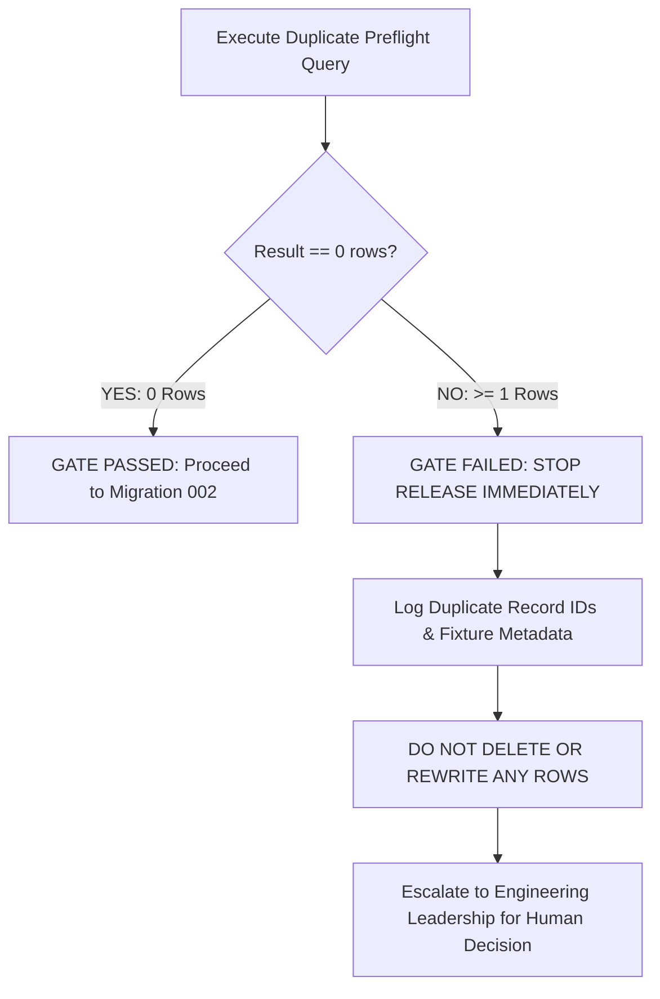

# SPORTYMILL — PRODUCTION PREFLIGHT EXECUTION TEMPLATE

**Document Reference:** `SPORTYMILL_PRODUCTION_PREFLIGHT_TEMPLATE.md`  
**Execution Context:** Production Database Inspection prior to Migration 002  
**Target Environment:** Production PostgreSQL Cluster (`sporty-cn2q`)  

---

## 1. PREFLIGHT EXECUTION PROTOCOL

> [!IMPORTANT]
> This template must be executed against the **actual production database** during the approved release window prior to applying any DDL. All queries in this template are strictly **read-only**.

---

## 2. PRODUCTION DATABASE INFRASTRUCTURE AUDIT

Execute the following diagnostic block via `psql` or an interactive administrative script:

```sql
-- 1. PostgreSQL Server Version
SELECT version();

-- 2. Transaction Isolation Level & Parameters
SHOW transaction_isolation;
SHOW max_connections;

-- 3. Current Active Connections
SELECT count(*) AS active_connections FROM pg_stat_activity WHERE state = 'active';

-- 4. Database Storage & Table Size
SELECT 
    pg_size_pretty(pg_database_size(current_database())) AS total_db_size,
    pg_size_pretty(pg_total_relation_size('prediction_logs')) AS prediction_logs_total_size;

-- 5. Existing Constraints and Indexes on prediction_logs
SELECT indexname, indexdef 
FROM pg_indexes 
WHERE tablename = 'prediction_logs' 
ORDER BY indexname;
```

### Infrastructure Recording Form:
* **Database Provider:** `[Render Managed / AWS RDS / Supabase]`
* **Observed PostgreSQL Version:** `[e.g. PostgreSQL 16.x / 18.x]`
* **Observed Isolation Level:** `[read committed]`
* **Active Connections / Max:** `[_____ / _____]`
* **Database Size:** `[_____ MB]`
* **Manual Snapshot Verified:** `[YES / NO — Timestamp: ____________________]`

---

## 3. HISTORICAL DATA INVENTORY & PROVENANCE BASELINE

Before altering schema or deploying live recording hooks, capture the exact state of all historical records.

```sql
-- 1. Total Count in prediction_logs
SELECT count(*) AS total_prediction_logs FROM prediction_logs;

-- 2. Breakdown by source_classification
SELECT source_classification, count(*) AS row_count 
FROM prediction_logs 
GROUP BY source_classification 
ORDER BY row_count DESC;

-- 3. Settlement Status Breakdown
SELECT outcome, count(*) AS status_count 
FROM prediction_logs 
GROUP BY outcome 
ORDER BY status_count DESC;

-- 4. Model Version Distribution
SELECT model_version, count(*) AS version_count 
FROM prediction_logs 
GROUP BY model_version 
ORDER BY version_count DESC;

-- 5. Oldest and Newest Record Timestamps
SELECT 
    min(created_at) AS oldest_record_created_at,
    max(created_at) AS newest_record_created_at 
FROM prediction_logs;
```

### Historical Baseline Recording Form:
* **Total Existing Rows:** `[Expected: ~523 rows]`
* **`provider_verified` Count:** `[Expected: 366 rows — Historical Backtests]`
* **`unverified` Count:** `[Expected: 87 rows — Historical Baseline Logs]`
* **`seed` Count:** `[Expected: 34 rows — Calibration Fixtures]`
* **`synthetic` Count:** `[Expected: 20 rows — Development Fixtures]`
* **`invalid` Count:** `[Expected: 16 rows — Malformed Lines]`
* **`live_recorded` Count:** `[Expected: 0 rows — Live tips have not yet begun]`
* **Historical Data Invariant:** Zero historical records may be deleted, updated, or backfilled during release.

---

## 4. DUPLICATE DATA PREFLIGHT QUERY FOR MIGRATION 002

This is the critical gate query. It verifies that no duplicate live predictions exist that would violate the partial unique index.

```sql
SELECT 
    provider_fixture_id, 
    endpoint, 
    COUNT(*) AS duplicate_count 
FROM prediction_logs 
WHERE source_classification = 'live_recorded' 
GROUP BY provider_fixture_id, endpoint 
HAVING COUNT(*) > 1;
```

### Preflight Gate Evaluation Rules:



### Preflight Outcome Certification:
* **Query Execution Timestamp:** `[____________________ UTC]`
* **Rows Returned:** `[____ rows]`
* **Gate Status:** `[PASSED / FAILED]`
* **Certified By (Release Engineer):** `[____________________]`
