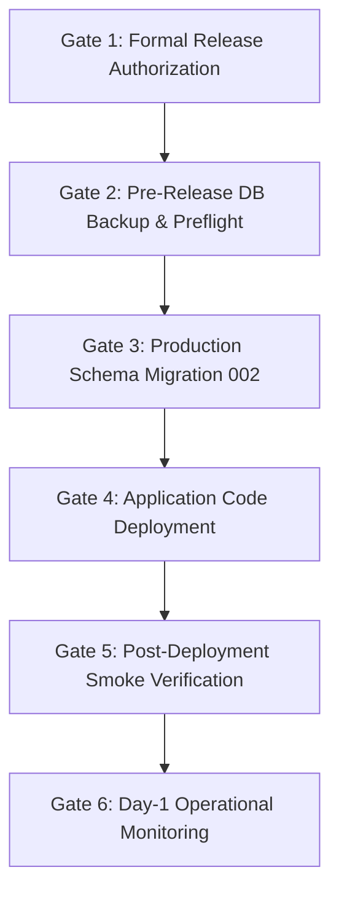

# SPORTYMILL — PRODUCTION RELEASE CHECKLIST

**Document Reference:** `SPORTYMILL_PRODUCTION_RELEASE_CHECKLIST.md`  
**Execution Date:** November 16, 2026  
**Integration Branch:** `integration-controlled` (Commit: `3499770`)  
**Production Target:** Render Web Service `sporty-cn2q` & PostgreSQL Database  

---

## 1. RELEASE GATE SUMMARY

This checklist enforces a strict zero-defect gate model. **Every checkbox must be verified and checked off before proceeding to the subsequent phase.** If any gate fails, the release is paused immediately.



---

## 2. PHASE-BY-PHASE EXECUTION CHECKLIST

### Gate 1: Governance & Authorization Sign-off
- [ ] **1.1 Lead Technical Advisor Written Authorization:** Formal confirmation received authorizing execution of the production release window.
- [ ] **1.2 Release Window Defined:** Maintenance / off-peak operational window agreed upon with stakeholders.
- [ ] **1.3 Operational Roles Assigned:**
  * Release Engineer: Antigravity / Lead DevOps
  * Database Administrator: On-call DBA
  * Incident Escalation Contact: Lead Technical Advisor
- [ ] **1.4 Baseline Integrity Confirmed:** Verified `main` is at `842aa67` and `main.py.baseline` matches `faf9fdd19e644d331c171bc1bb676a01994cdb3fd650c13d6ae34cb81702238a`.

---

### Gate 2: Pre-Release Database Backup & Preflight (T - 30 Minutes)
- [ ] **2.1 Production Database Manual Snapshot:**
  * Navigate to [dashboard.render.com](https://dashboard.render.com) $\rightarrow$ PostgreSQL Service $\rightarrow$ **Backups**.
  * Click **Create Manual Backup**.
  * Confirm backup status changes to `Completed` with valid timestamp.
- [ ] **2.2 Connection Limit & Disk Capacity Audit:**
  * Query: `SELECT count(*) FROM pg_stat_activity;` (ensure $< 70\%$ pool limit).
  * Check disk space on database instance (ensure $> 20\%$ free disk).
- [ ] **2.3 Production Duplicate-Data Preflight Query:**
  * Execute read-only query against production:
    ```sql
    SELECT provider_fixture_id, endpoint, COUNT(*) AS duplicate_count 
    FROM prediction_logs 
    WHERE source_classification = 'live_recorded' 
    GROUP BY provider_fixture_id, endpoint 
    HAVING COUNT(*) > 1;
    ```
  * **Result Verified:** Exactly `0 rows` returned.
  * *Gate Rule:* If $>0$ rows, STOP immediately. Do NOT create index.
- [ ] **2.4 Production Historical Record Inventory:**
  * Execute read-only inventory query:
    ```sql
    SELECT source_classification, count(*) 
    FROM prediction_logs 
    GROUP BY source_classification;
    ```
  * Record baseline row counts (expected: ~523 historical rows, 0 `live_recorded`).
- [ ] **2.5 Production Environment Variables Verified:**
  * In Render Dashboard $\rightarrow$ Web Service `sporty-cn2q` $\rightarrow$ **Environment**:
    * `DATABASE_URL`: Valid production PostgreSQL URI configured.
    * `ADMIN_TOKEN`: Strong 64-character random hex token configured.
    * `SECRET_KEY`: Configured.

---

### Gate 3: Production Schema Migration Execution
- [ ] **3.1 Schema Compatibility Pre-check:**
  * Run: `python scripts/migrate_sqlite_to_postgres.py --verify-only`
  * Verify 0 table/column mismatches.
- [ ] **3.2 Execute Migration 002 Upgrade:**
  * *Option A (Maintenance Window / Standard DDL):*
    ```sql
    CREATE UNIQUE INDEX IF NOT EXISTS uq_prediction_logs_live_fid_endpoint 
    ON prediction_logs (provider_fixture_id, endpoint) 
    WHERE source_classification = 'live_recorded';
    ```
  * *Option B (Live Traffic / Concurrent DDL):*
    ```sql
    CREATE UNIQUE INDEX CONCURRENTLY IF NOT EXISTS uq_prediction_logs_live_fid_endpoint 
    ON prediction_logs (provider_fixture_id, endpoint) 
    WHERE source_classification = 'live_recorded';
    ```
- [ ] **3.3 Index Validity Verification:**
  * Query system catalog:
    ```sql
    SELECT c.relname AS index_name, i.indisvalid, i.indisready 
    FROM pg_index i 
    JOIN pg_class c ON c.oid = i.indexrelid 
    WHERE c.relname = 'uq_prediction_logs_live_fid_endpoint';
    ```
  * **Assert:** `indisvalid = true` AND `indisready = true`.

---

### Gate 4: Application Code Deployment
- [ ] **4.1 Git Fast-Forward Merge to `main`:**
  ```bash
  git checkout main
  git pull origin main
  git merge --ff-only integration-controlled
  ```
  * Verify HEAD commit on `main` is `3499770`.
- [ ] **4.2 Git Release Tagging:**
  ```bash
  git tag -a v21.1.0-live-settlement -m "Release v21.1.0: Live prediction persistence ledger and OCC settlement engine"
  ```
- [ ] **4.3 Deploy Trigger (Git Push):**
  ```bash
  git push origin main --tags
  ```
- [ ] **4.4 Render Build & Rolling Deploy Monitoring:**
  * Watch deployment logs in Render Dashboard.
  * Verify dependency installation (`asyncpg==0.32.0`, `sqlalchemy==2.0.54`).
  * Verify startup log: `Application startup complete.`
  * Confirm rolling deploy health check succeeds and routes live traffic.

---

### Gate 5: Post-Deployment Smoke Verification (T + 5 Minutes)
- [ ] **5.1 Public Health Telemetry Check:**
  ```bash
  curl -s -i https://sporty-cn2q.onrender.com/health
  ```
  * **Assert:** HTTP 200 OK, `{"status": "ok", "database": "connected"}`.
- [ ] **5.2 Administrative Settlement Authorization Check:**
  * *Negative Test (Unauthorized):*
    ```bash
    curl -s -o /dev/null -w "%{http_code}\n" -X POST https://sporty-cn2q.onrender.com/admin/settle-live-predictions
    ```
    * **Assert:** HTTP `401` Unauthorized.
  * *Positive Test (Authorized with Admin Token):*
    ```bash
    curl -s -X POST https://sporty-cn2q.onrender.com/admin/settle-live-predictions \
      -H "X-Admin-Token: $ADMIN_TOKEN" | jq .
    ```
    * **Assert:** HTTP `200` OK, `{"status": "success", "report": {...}}`.
- [ ] **5.3 Public Match Feed Inspection:**
  * Open `https://sporty-cn2q.onrender.com` in browser.
  * Confirm live fixtures render properly with odds and probabilities.
  * Confirm pre-kickoff predictions are captured in `prediction_logs` with `source_classification = 'live_recorded'`.
- [ ] **5.4 Historical Record Count Audit:**
  * Confirm the 523 historical records remain 100% intact with original classifications.

---

### Gate 6: Day-1 Operational Monitoring (T + 24 Hours)
- [ ] **6.1 Scheduled Settlement Automation:**
  * Configure Render Cron Job or external scheduler to invoke `POST /admin/settle-live-predictions` periodically (e.g. every 60 minutes) with `X-Admin-Token`.
- [ ] **6.2 Application Error Telemetry:**
  * Monitor Render metrics for HTTP 5xx responses (target: $< 0.05\%$).
- [ ] **6.3 OCC Concurrency & Financial Outcome Audit:**
  * Query settled live predictions:
    ```sql
    SELECT outcome, count(*), sum(unit_return) 
    FROM prediction_logs 
    WHERE source_classification = 'live_recorded' AND outcome != 'pending' 
    GROUP BY outcome;
    ```
  * Confirm zero duplicate settlement records or status churn.
