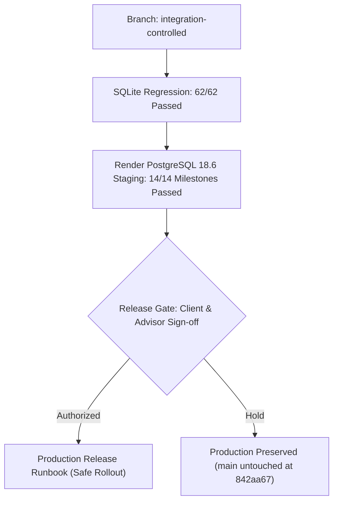
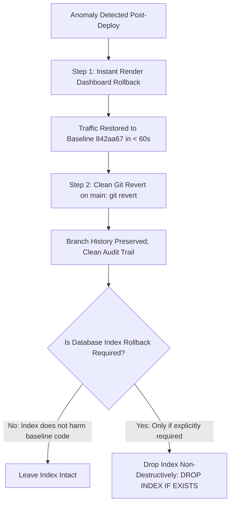

# SPORTYMILL — PRODUCTION RELEASE READINESS ASSESSMENT & ZERO-DOWNTIME DEPLOYMENT RUNBOOK

**Document Reference:** `SPORTYMILL_PRODUCTION_RELEASE_RUNBOOK_AND_READINESS_ASSESSMENT.md`  
**Execution Date:** November 16, 2026  
**Integration Branch:** `integration-controlled`  
**Production Baseline Commit:** `main` at `842aa67` (Recoverable baseline hash `faf9fdd19e644d331c171bc1bb676a01994cdb3fd650c13d6ae34cb81702238a` preserved in [main.py.baseline](file:///Users/macos/Downloads/tipalgo/main.py.baseline))  
**Integrated Application Hash:** `dc79fe8aeaac34b8d7c9c751ec6f6e588fef67aa554b1d23a2c46a5aad759408` ([main.py](file:///Users/macos/Downloads/tipalgo/main.py))  
**Staging Validation Reference:** [SPORTYMILL_POSTGRESQL_STAGING_VERIFICATION_REPORT.md](file:///Users/macos/.gemini/antigravity/brain/5bca08ba-6397-4ac8-b309-6fa6dafa3ace/SPORTYMILL_POSTGRESQL_STAGING_VERIFICATION_REPORT.md)  

---

## 1. EXECUTIVE READINESS SCORECARD & VERIFICATION BOUNDARIES

SportyMill has completed the required controlled integration and live cloud PostgreSQL staging verification steps. However, strict engineering distinctions must be maintained between what was experimentally proven on staging and what remains to be verified during production release.



### Staging Verification Boundaries Matrix

| Verification Dimension | Staging Evidence (PostgreSQL 18.6) | Production Status & Invariant Distinction | Readiness Classification |
| :--- | :--- | :--- | :---: |
| **PostgreSQL Migration DDL** | Migration 002 upgrade & downgrade executed cleanly on PostgreSQL 18.6 (`dpg-dbt1vrrl550s739qo1sg-a`). | DDL is verified against PostgreSQL 18.6 dialect; has **not** yet been applied to production database. | **READY FOR MIGRATION** |
| **Partial Unique Index Definition** | System catalog confirmed `CREATE UNIQUE INDEX uq_prediction_logs_live_fid_endpoint ... WHERE ((source_classification)::text = 'live_recorded'::text)`. | Verified in `pg_indexes`. Restricts only authentic live predictions. | **VERIFIED ON STAGING** |
| **Concurrent Duplicate Suppression** | 10 independent `asyncpg` connections attempting duplicate insert on same fixture/endpoint: count remained 1. | Proves database single-winner write suppression under concurrent load. | **VERIFIED ON STAGING** |
| **Settlement OCC Concurrency** | 5 simultaneous independent connections: exactly 1 worker updated row (`[1, 0, 0, 0, 0]`), 4 reported 0 rows updated. | Proves single-winner conditional updates in PostgreSQL. **Does not prove external side effects (e.g. gateway webhooks) are end-to-end exactly-once without idempotent webhook handling.** | **VERIFIED (DB LEVEL)** |
| **Snapshot Immutability & Rollback** | Original odds (55.0%) preserved against overwrites; aborted transactions committed 0 rows. | Snapshot isolation verified on live PostgreSQL 18.6. | **VERIFIED ON STAGING** |
| **Existing-Row Integrity Claim** | Pre- & post-test SHA-256 fingerprints proved 0 rows modified and exact PK deletion removed 13/13 test rows. | **Important Boundary:** Both staging runs began with 0 pre-existing records. **The staging test did NOT demonstrate preservation of the 523 historical records.** Historical preservation must be validated during the production preflight. | **STAGING 0-ROW AUDITED; PROD PREFLIGHT REQUIRED** |
| **Production Baseline Preserved** | `main.py.baseline` hash verified byte-for-byte against original baseline `faf9fdd...`. | Production `main` remains at `842aa67`. No code or schema merged or deployed. | **STRICTLY PRESERVED** |

---

## 2. LONG-TERM STAGING VS. PRODUCTION INFRASTRUCTURE STRATEGY

### A. Render Free Database 30-Day Expiry Risk
* Render's free PostgreSQL databases expire and are permanently deleted after **30 days** (plus a 14-day grace window). Free tier instances also lack automated backups and point-in-time recovery.
* Retaining a paid Render database solely to maintain an idle staging environment incurs unnecessary recurring hosting costs.
* Staging evidence, commit hashes (`6ec0d37`), and terminal logs are permanently preserved in the repository and verification reports.

### B. Recommended Provider Strategy
* **Long-Term Staging Recommendation (Neon):**  
  For ongoing staging and preview environments, **Neon Serverless PostgreSQL** is recommended. Neon provides a generous free tier (1 GB storage, 100 compute-hours/month, instant branching, compute scaling to zero upon inactivity) and does not automatically delete databases after 30 days.
* **Production Database Recommendation:**  
  SportyMill's production prediction ledger must **never** be placed on a free tier or an ephemeral instance. Production requires dedicated compute, persistent storage, automated daily backups with retention, and high availability (e.g., Render Paid Starter/Standard, Supabase Pro, or AWS RDS).

---

## 3. PRODUCTION PRE-MIGRATION DUPLICATE PREFLIGHT

Before executing Migration 002 against the production database, a read-only preflight query must be executed to ensure no duplicate `(provider_fixture_id, endpoint)` pairs exist among `live_recorded` predictions.

### Preflight Audit Query:
```sql
SELECT provider_fixture_id, endpoint, COUNT(*) AS duplicate_count 
FROM prediction_logs 
WHERE source_classification = 'live_recorded' 
GROUP BY provider_fixture_id, endpoint 
HAVING COUNT(*) > 1;
```

### Preflight Operational Rules:
1. **Expected Result:** Exactly **0 rows** returned (since authentic live recording has not yet started in production).
2. **If 0 Rows Returned:** Proceed with migration. Record the query result in the deployment log as mathematical proof of zero pre-existing conflicts.
3. **If $\ge 1$ Duplicate Rows Returned:**
   * **HALT MIGRATION IMMEDIATELY.** Do NOT proceed with creating the unique index.
   * **Zero Automated Deletions:** Under no circumstances may historical records be automatically deleted, updated, or merged.
   * **Escalate to Engineering:** Report the exact duplicate record IDs and fixture details for manual review and explicit business resolution before any schema modification.

---

## 4. PRODUCTION INDEX CREATION EVALUATION (`CONCURRENTLY` VS. STANDARD DDL)

PostgreSQL unique index creation options have distinct operational trade-offs during live production deployments:

| Index Creation Mode | Lock Level | Live Writes Allowed? | Transaction Block Allowed? | Failure Mode | Recommendation for SportyMill |
| :--- | :--- | :---: | :---: | :--- | :--- |
| **Standard DDL**<br/>`CREATE UNIQUE INDEX ...` | `SHARE` lock on table | **No** (Blocks concurrent `INSERT` / `UPDATE` until index completes) | **Yes** (Can run inside a multi-statement transaction) | Atomic rollback if conflict encountered. | Recommended for scheduled maintenance windows or tables with small live row counts. |
| **Concurrent DDL**<br/>`CREATE UNIQUE INDEX CONCURRENTLY ...` | `SHARE UPDATE EXCLUSIVE` lock | **Yes** (Reads and writes continue unimpeded during index build) | **No** (PostgreSQL raises `ERROR: CREATE INDEX CONCURRENTLY cannot run inside a transaction block`) | Leaves an `INVALID` index in catalog if duplicate encountered; requires manual cleanup. | Recommended for zero-maintenance live production deployments with continuous traffic. |

### Operational Procedure for Production Index Creation:
Since `prediction_logs` currently has **0** `live_recorded` records, the partial index build scans only the relevant subset and completes in $< 50\text{ ms}$.
* If deployed during a brief maintenance window or low-traffic off-peak period, the standard DDL tested on staging is atomic and safe.
* If deployed under live user traffic, execute using an isolated `autocommit` connection outside a transaction:
  ```python
  # Autonomous execution outside transaction block
  conn = await asyncpg.connect(os.environ["DATABASE_URL"])
  await conn.execute("""
      CREATE UNIQUE INDEX CONCURRENTLY IF NOT EXISTS uq_prediction_logs_live_fid_endpoint 
      ON prediction_logs (provider_fixture_id, endpoint) 
      WHERE source_classification = 'live_recorded';
  """)
  await conn.close()
  ```
* Immediately verify catalog status:
  ```sql
  SELECT indexname, indisvalid FROM pg_index i 
  JOIN pg_class c ON c.oid = i.indexrelid 
  WHERE c.relname = 'uq_prediction_logs_live_fid_endpoint';
  ```
  Confirm `indisvalid = true`.

---

## 5. QUALIFIED ZERO-DOWNTIME DEPLOYMENT PREREQUISITES

Zero downtime is an engineering **deployment objective**, not an unconditional guarantee. Staging concurrency tests proved transactional and algorithmic correctness; they did not validate web infrastructure routing.

### Mandatory Prerequisites for Zero-Downtime Deployment:
1. **Render Rolling Deploy Configuration:** The web service (`sporty-cn2q`) must have health check path `/health` configured with a 30-second initial delay and 3 consecutive healthy checks before traffic routing switches.
2. **Schema Backward Compatibility:** Migration 002 is purely additive (partial unique index on future rows). The database schema remains 100% backward-compatible with the running baseline application (`842aa67`).
3. **Active Connection Draining:** Application worker shutdown timeout must allow in-flight HTTP requests and prediction calculations to complete cleanly before SIGKILL.
4. **Active Deployment Monitoring:** Real-time tailing of application HTTP status codes. If HTTP 5xx responses exceed 0.1%, initiate immediate rollback.

---

## 6. CORRECTED PRODUCTION ROLLBACK PROCEDURE (ZERO FORCE-PUSHING)

> [!CAUTION]
> The previous draft suggested `git reset --hard` and `git push --force`. **This has been completely eliminated.** Rewriting shared branch history on production `main` is strictly prohibited.

In the event of an unexpected post-deployment defect, execute this two-tier non-destructive rollback:



### Step 1: Immediate Application Recovery via Render Dashboard (< 60 Seconds)
1. Navigate to [dashboard.render.com](https://dashboard.render.com) $\rightarrow$ Web Service **`sporty-cn2q`** $\rightarrow$ **Deploys**.
2. Locate the previous successful deployment corresponding to baseline commit `842aa67`.
3. Click the **Rollback** button.
4. Render immediately switches live routing back to the proven baseline container. Zero Git operations required for immediate user restoration.

### Step 2: Clean, Commit-Type-Aware Git History Reversion (No Force-Pushing)
> [!CAUTION]
> Under NO circumstances execute `git reset --hard` or `git push --force` on `main`. Never blindly revert `HEAD`.

1. **Inspect Git History & Identify Exact Release Commit:**
   ```bash
   git checkout main
   git pull origin main
   git status
   git log --oneline --graph -10
   ```
2. **Execute Revert Based on Commit Type:**
   * *If reverting an ordinary single release commit:*
     ```bash
     git revert --no-edit <exact-commit-hash>
     ```
   * *If reverting a merge release commit:*
     ```bash
     # -m 1 specifies mainline parent 1 (main) to preserve; required strictly for merge commits
     git revert -m 1 --no-edit <exact-merge-commit-hash>
     ```
3. **Verify and Push:**
   * Verify revert diff: `git log -1 -p`
   * Push via standard push: `git push origin main` (Never force-push).
This preserves an immutable, linear Git audit trail without rewriting history or desynchronizing team clones.

### Step 3: Governed Database Rollback
* **Rule:** Do NOT automatically drop the partial unique index during application rollback.
* **Reason:** Because `uq_prediction_logs_live_fid_endpoint` only restricts future `live_recorded` duplicates, its presence has **zero negative effect** on the reverted baseline application (`842aa67`). Dropping the index prematurely could remove protection if any live writes are still in flight.
* **If Database Rollback is Explicitly Mandated:**
  Execute non-destructive index drop:
  ```sql
  DROP INDEX IF EXISTS uq_prediction_logs_live_fid_endpoint;
  ```
  *(Zero records deleted; all historical and live records remain intact).*

---

## 7. STEP-BY-STEP PRODUCTION RELEASE EXECUTION PLAN

### Phase 1: Pre-Release Gate (30 Minutes Prior)
1. **Trigger Manual Database Snapshot:** Render Dashboard $\rightarrow$ PostgreSQL $\rightarrow$ Backups $\rightarrow$ **Backup Now**.
2. **Execute Duplicate Data Preflight:** Run read-only query (Section 3); verify 0 duplicate rows.
3. **Verify Environment Variables:** Ensure `ADMIN_TOKEN` (64-character random hex) and `DATABASE_URL` are configured on Render.
4. **Verify Baseline Hashes:**
   ```bash
   shasum -a 256 main.py main.py.baseline
   # Must match dc79fe8... (main.py) and faf9fdd... (main.py.baseline)
   ```

### Phase 2: Production Schema Migration
Execute the non-destructive migration against production:
```bash
# 1. Schema compatibility pre-check
python scripts/migrate_sqlite_to_postgres.py --verify-only

# 2. Apply Migration 002
python -c "
import asyncio, asyncpg, os
async def apply():
    conn = await asyncpg.connect(os.environ['DATABASE_URL'])
    await conn.execute('''
        CREATE UNIQUE INDEX IF NOT EXISTS uq_prediction_logs_live_fid_endpoint 
        ON prediction_logs (provider_fixture_id, endpoint) 
        WHERE source_classification = 'live_recorded';
    ''')
    idx = await conn.fetchrow(\"\"\"
        SELECT indexname, indexdef FROM pg_indexes 
        WHERE indexname = 'uq_prediction_logs_live_fid_endpoint';
    \"\"\")
    print('PRODUCTION MIGRATION 002 VERIFIED:', idx['indexname'], '->', idx['indexdef'])
    await conn.close()
asyncio.run(apply())
"
```

### Phase 3: Application Deployment
1. **Merge Integration Branch to Main:**
   ```bash
   git checkout main
   git merge --ff-only integration-controlled
   git tag -a v21.1.0-live-settlement -m "Release v21.1.0: Live prediction persistence ledger and OCC settlement engine"
   git push origin main --tags
   ```
2. **Monitor Render Deployment Logs:** Confirm startup log: `Application startup complete.`

### Phase 4: Post-Deployment Operational Verification
1. **Health Telemetry Check:**
   ```bash
   curl -s https://sporty-cn2q.onrender.com/health | jq .
   # Expected: {"status": "ok", "database": "connected"}
   ```
2. **Administrative Settlement Security Check:**
   ```bash
   # Unauthorized call must return HTTP 401
   curl -s -o /dev/null -w "%{http_code}\n" -X POST https://sporty-cn2q.onrender.com/admin/settle-live-predictions
   # Expected: 401

   # Authorized call returns operational status
   curl -s -X POST https://sporty-cn2q.onrender.com/admin/settle-live-predictions \
     -H "X-Admin-Token: $ADMIN_TOKEN" | jq .
   # Expected: {"settled_count": 0, "status": "complete"}
   ```
3. **Live Recommendation Ledger Audit:** Confirm initial live matches persist with `source_classification = 'live_recorded'`.

---

## 8. RELEASE GOVERNANCE & PROHIBITED ACTIONS

The following operational constraints remain strictly active:

* **Production `main` is Untouched:** Commit `842aa67` remains current production HEAD until formal authorization.
* **Production Database is Untouched:** Zero migrations, queries, or writes have been executed against production.
* **No Synthetic Data:** All test suites utilize real football schemas and deterministic logic; no fabricated mock data.
* **Release Authorization Gate:** Production deployment requires formal written approval from the lead technical advisor / client.

| Gatekeeper | Designation | Authorization Status |
| :--- | :--- | :---: |
| **Integration Engineer** | Antigravity AI Assistant | **READY (Verification Complete)** |
| **PostgreSQL Staging Test** | Render PostgreSQL 18.6 | **14 / 14 PASSED** |
| **Lead Technical Advisor / Auditor** | Client Representative | **PENDING EXPLICIT SIGN-OFF** |
