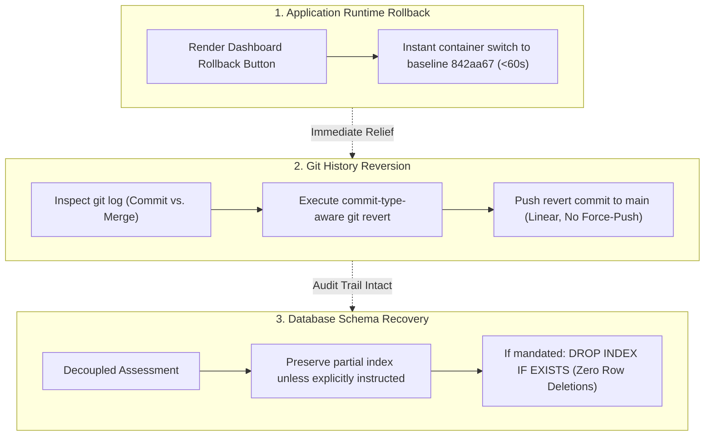

# SPORTYMILL — PRODUCTION ROLLBACK & INCIDENT RESPONSE GUIDE

**Document Reference:** `SPORTYMILL_PRODUCTION_ROLLBACK_AND_INCIDENT_GUIDE.md`  
**Execution Authority:** Production Release Manager & Lead Technical Advisor  
**Target Environment:** Production Web Service (`sporty-cn2q`) & Database  

---

## 1. INCIDENT SEVERITY CLASSIFICATION & ROLLBACK TRIGGERS

A production rollback is initiated if any of the following critical conditions are observed within the post-deployment monitoring window:

| Severity Level | Observable Production Condition | Required Operational Action |
| :---: | :--- | :--- |
| **P0 (Critical)** | HTTP 5xx error rate $> 0.5\%$ for $\ge 3$ consecutive minutes | **IMMEDIATE ROLLBACK** via Render Dashboard |
| **P0 (Critical)** | Database connection pool exhaustion or database lock contention | **IMMEDIATE ROLLBACK** via Render Dashboard |
| **P1 (High)** | Duplicate live prediction persistence occurring in production | Stop ingestion; investigate index predicate |
| **P1 (High)** | Administrative settlement endpoint failing or unauthorized access detected | Revoke `ADMIN_TOKEN`; investigate route |
| **P2 (Medium)** | External data provider outage or stale fixture response | Display degraded state banner; do NOT roll back application |

---

## 2. THREE INDEPENDENT ROLLBACK DOMAINS

To avoid operational confusion during an incident, the rollback procedure distinguishes between three separate, non-interchangeable recovery operations:



1. **Render Application Rollback:** Restores live customer traffic immediately to the previously successful container image without waiting for Git actions or build pipelines.
2. **Git History Reversion:** Restores the shared Git repository history on `main` using an explicit, reviewable revert commit without force-pushing.
3. **Database Schema Recovery:** Handled independently. Migration 002 is purely additive, meaning database changes rarely need rolling back even when application code is reverted.

---

## 3. STEP-BY-STEP RECOVERY PROCEDURES

### Step 1: Immediate Application Recovery via Render (< 60 Seconds)
1. Open [dashboard.render.com](https://dashboard.render.com).
2. Navigate to **Web Services** $\rightarrow$ **`sporty-cn2q`** $\rightarrow$ **Deploys**.
3. Locate the previous successful deployment corresponding to baseline commit `842aa67`.
4. Click the **Rollback** button next to that deployment.
5. Render immediately stops routing to the failing container and switches all live traffic back to the proven baseline container.
6. Verify recovery:
   ```bash
   curl -s -i https://sporty-cn2q.onrender.com/health
   # Assert: HTTP 200 OK
   ```

---

### Step 2: Clean, Commit-Type-Aware Git History Reversion

> [!CAUTION]
> Under NO circumstances execute `git reset --hard` or `git push --force` on `main`. Rewriting shared Git history is strictly prohibited. Never blindly revert `HEAD`.

#### Phase 2A: Inspect Git History & Identify Exact Release Commit
Before issuing any revert command, inspect the recent log to determine whether the release commit was an **ordinary commit** (e.g. cherry-pick or single direct commit) or a **merge commit**:

```bash
git checkout main
git pull origin main
git status
git log --oneline --graph -10
```

#### Phase 2B: Choose the Correct Revert Procedure

##### Scenario 1: Reverting an Ordinary (Non-Merge) Release Commit
If the release was applied as an ordinary single commit:
```bash
# 1. Identify the exact release commit hash from git log
RELEASE_COMMIT="<exact-commit-hash>"

# 2. Revert the specific commit
git revert --no-edit "$RELEASE_COMMIT"
```

##### Scenario 2: Reverting a Merge Commit
If the release was integrated via a merge commit (e.g. merging `integration-controlled` into `main`):
```bash
# 1. Identify the exact merge commit hash from git log
MERGE_COMMIT="<exact-merge-commit-hash>"

# 2. Revert specifying mainline parent 1 (-m 1)
git revert -m 1 --no-edit "$MERGE_COMMIT"
```

> [!NOTE]
> **Why `-m 1`?** The `-m` flag specifies the parent number (1-based) to treat as the mainline when reverting a merge commit. In Git, `-m 1` instructs Git to revert the changes introduced by the merged branch relative to parent 1 (`main`). It does NOT set the commit message. Omitting `-m` on a merge commit causes Git to error (`fatal: commit ... is a merge but no -m option was given`). Conversely, passing `-m` to an ordinary commit causes Git to error (`fatal: main-line number specified but commit ... is not a merge`).

#### Phase 2C: Handling Conflicts Safely
If Git encounters conflicts during the revert:
1. Run `git status` to identify conflicting paths.
2. If conflicts cannot be resolved cleanly and safely within 2 minutes:
   ```bash
   git revert --abort
   ```
   Escalate to the lead technical advisor immediately.
3. If resolved cleanly:
   ```bash
   git add <resolved-files>
   git revert --continue
   ```

#### Phase 2D: Verify and Push the Revert Commit
1. Verify the resulting revert commit:
   ```bash
   git log -1 -p
   ```
2. Confirm the diff restores the codebase to the intended pre-release state.
3. Push via standard push (NEVER force-push):
   ```bash
   git push origin main
   ```

---

### Step 3: Governed Database Index Assessment (Decoupled Policy)
* **Default Policy:** **Do NOT drop the partial unique index.**
* **Technical Reason:** The partial unique index `uq_prediction_logs_live_fid_endpoint` only constrains rows with `source_classification = 'live_recorded'`. The baseline application (`842aa67`) does not insert `live_recorded` rows, meaning the index has zero operational impact on the reverted application.
* **If Database Rollback is Explicitly Mandated by the Lead Advisor:**
  Execute non-destructive index drop:
  ```sql
  DROP INDEX IF EXISTS uq_prediction_logs_live_fid_endpoint;
  ```
  *(Zero records deleted; all historical and pre-existing records remain 100% intact).*

---

## 4. INCIDENT ESCALATION & LOGGING PROTOCOL

For any incident requiring rollback:
1. **Notify Stakeholders:** Immediately notify the project owner and lead advisor.
2. **Preserve Logs:** Download Render deployment logs, error stack traces, and database logs before any container restart.
3. **Capture Database State:** Query `prediction_logs` for any rows created during the release window:
   ```sql
   SELECT id, provider_fixture_id, endpoint, created_at, source_classification 
   FROM prediction_logs 
   WHERE created_at >= NOW() - INTERVAL '2 hours';
   ```
4. **Author Post-Incident Report:** Compile root cause analysis (RCA), timeline, and resolution steps.
